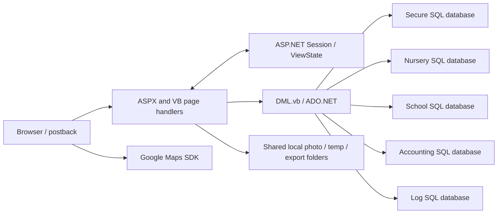

# Current system: functions and workflows

## Application structure

The solution is a Web Site, not a modern API/service application. IIS/ASP.NET compiles `.aspx`, VB code-behind, and `App_Code` at runtime. `Web.config` compiles for .NET Framework 4.8 while `httpRuntime` still specifies 4.5; VB strict mode is disabled. `packages.config` retains net45 package targets. There is no discovered migration project, SQL schema repository, automated test suite, or populated CI workflow.

The browser uses server controls, full postbacks, UpdatePanels, jQuery versions 1.5.1/1.9.1/2.1.3/3.2.1, jQuery UI, Zebra DatePicker, and AjaxControlToolkit. CSS fixes forms around 470–600 px, repeats table layouts and inline styles, and some pages request IE7/IE9 emulation and disable user zoom. There is no shared master layout, modern design system, route model, API contract, or feature boundary. Individual pages duplicate session cleanup and validation.

The request path is:

The database behavior described below includes the [read-only follow-up](07-database-inspection.md) for the configured active Secure/Nursery/School catalogs. Accounting and Logging are unavailable; deployed production parity is not established.

## Core identities and state

- `Session("UserID")` identifies a **dealer/admin account**, not a center administrator. The latter lives in the separate `Center_Users` domain.
- A center is identified by **both** ID and type. Selectors encode it as `center_id_center_type`. Nursery = 1, Lite = 3, School = 4. SQL/photo routing sends School to school resources and every other type to nursery resources. The creation UI offers Nursery/School; Lite remains a compatibility value.
- Center selection sets `CareCenterID`, `CareCenterType`, and sometimes `CareCenterName`. Wizard state uses `CareCenter`, `Photos`, `Location`, `User`; edits use `CareCenterEdited`, `inputTypeEdited`, `UserEdited`, `OldUserName`.
- Grids cache whole DataTables in session: `GridDataset` is shared by unrelated pages, with additional `CentersStatusData`, `PaymentsDataSet`, `CurrenciesDataSet`, and bus setting datasets. Concurrent tabs can overwrite one another's state. Most navigation erases every session key except UserID and optionally Status.
- Pages often depend on `UrlReferrer.Segments.Last`, session presence, and `Not IsPostBack`; refresh, deep links, missing referrer headers, and opening multiple workflows are brittle.

## Every page and its behavior

| Legacy page                  | Actual responsibility                                      | State / data / effects                                                                                                                                 | Rebuild destination                           |
| ---------------------------- | ---------------------------------------------------------- | ------------------------------------------------------------------------------------------------------------------------------------------------------ | --------------------------------------------- |
| `login.aspx`                 | Username/password sign-in                                  | Calls `authenticateDealer`; positive dealer ID becomes session UserID; generic failure label and alert                                                 | Identity provider sign-in                     |
| `Index.aspx`                 | Button-based home navigation and logout                    | Queries super-admin status; special dealer IDs 4/5; cleans temporary images and workflow sessions                                                      | `/`                                           |
| `CareCenterInfo.aspx`        | New-center details, type, currency, school academic year   | Required textbox scan, phone regex, alphanumeric unique domain, center-name precheck; saves draft in session                                           | `/centers` creation wizard                    |
| `SelectPhotos.aspx`          | New logo, center image, watermark                          | Optional reuse of logo as photo; saves shared temp files, updates draft filenames; dimension checks                                                    | Center wizard: branding                       |
| `SelectLocation.aspx`        | New-center map and coordinates                             | Draggable Maps marker; stores **longitude,latitude** string; defaults Beirut coordinates server-side when both blank                                   | Center wizard: location                       |
| `AddUser.aspx`               | Initial center-admin account                               | Suggests `admin`; first/last name, email, username, password/confirmation; uniqueness against secure DB; `username@domain`                             | Center wizard: administrator invite           |
| `Summary.aspx`               | Final center/account review and commit                     | Displays password; calls create-center SP, copies template `00000` photo tree, moves files; no atomic SQL/file transaction                             | Center wizard: review/provisioning            |
| `SelectCenter.aspx`          | Select an authorized center                                | Dealer-scoped selector; saves ID, type, name in session                                                                                                | `/centers` directory                          |
| `EditCenterList.aspx`        | Center editing menu                                        | Links details/photos/location; hidden disabled child-images link points to missing `ChildImages.aspx`                                                  | Center detail tabs                            |
| `ManageCareCenter.aspx`      | Edit center details and child input mode                   | Loads profile and fallback input type; stages review object; domain shown but not persisted by update SP call                                          | Center detail: profile/settings               |
| `EditSummary.aspx`           | Commit edited center and generate QR images                | Calls update-center SP; for input type 3 enumerates children, generates QR DB codes and images                                                         | Profile save / background QR job              |
| `EditPhotos.aspx`            | Replace branding independently                             | Uploads directly into center folders before final submit; updates DB filenames, renames watermark                                                      | Center detail: branding                       |
| `EditLocation.aspx`          | Read/update map coordinates                                | DB read reverses stored order for Maps; update serializes longitude first; only nonempty hidden fields validated server-side                           | Center detail: location                       |
| `SelectUser.aspx`            | Choose center whose admin will be edited                   | Sets center ID/type, then navigates to user form                                                                                                       | `/users` with center filter                   |
| `ManageUser.aspx`            | Edit center-admin name/email/password                      | Gets admin account from secure DB; password not loaded by current DML; username displayed and staged, but update call omits username                   | Center detail: administrator                  |
| `UserSummary.aspx`           | Review/commit admin edit                                   | Displays newly entered password; calls update SP and reports success regardless of returned status                                                     | User confirmation/reset flow                  |
| `AddDealer.aspx`             | Create dealer                                              | Initial-load admin check; name/email/username/password/confirmation and admin radio; update SP with ID -1 and active true                              | `/dealers` creation                           |
| `SelectDealer.aspx`          | Admin selects dealer to edit                               | Admin check on initial load; stores DealerID/DealerToEdit                                                                                              | `/dealers` directory                          |
| `ManageDealer.aspx`          | Update dealer                                              | Edits identity/password; admin radio filled but not assigned back before save; no active toggle; success ignores Boolean return                        | Dealer detail/permissions                     |
| `CenterActivity.aspx`        | Select centers, month/year, export class activity workbook | Dealer filter for admins; one sheet per selected center; demo/billable totals; logs child names; **updates invoice tracker after download**            | `/activity`                                   |
| `ClassChildrenActivity.aspx` | Render nursery monthly or school-year class report         | Class logos/counts, nursery active-day buckets and demo deductions; school academic-year selector; manually builds HTML; no home link to this page     | `/activity` detail                            |
| `CenterReport.aspx`          | Selected-center summary Excel export                       | Center ID, dealer, name, non-demo active >13 count; include inactive/exclude zero switches; select/unselect all; current working-copy changes included | `/reports`                                    |
| `CenterStatus.aspx`          | Filter and activate/deactivate centers                     | Dealer/status filters; sorting; inactive rows red; calls secure activation SP with dealer/center/type                                                  | `/status`                                     |
| `CenterCowPay.aspx`          | Duplicate center activation screen despite name            | Uses center statuses and activation SP; no CowPay credentials; not wired from home                                                                     | Consolidate into `/status` after confirmation |
| `CenterPayments.aspx`        | Manual center payment ledger                               | Filter center/status/dates; add/edit/delete; title, amount, currency, due date, month/year, description, URL; per-currency totals                      | `/payments`                                   |
| `CenterCowPaySettings.aspx`  | Manage per-center gateway configuration                    | Dealer filter; enabled flag; merchant code/hash key, live/staging token, displayed callback URL; configured/enabled row colors                         | `/integrations`                               |
| `CenterAlertMessage.aspx`    | Bulk or single-center alert and expiry                     | Dealer/status filters, active default, select all; message text/date; bulk reset button admin-visible; per-row RESET handler does nothing              | `/alerts`                                     |
| `iCareBusSettings.aspx`      | Per-bus dwell/geofence/passenger input configuration       | Center→bus selectors; school/nursery reference data; bus-specific or -1 fallback; upsert settings                                                      | `/transport`                                  |

All pages other than login contain a session login guard. That is **not** equivalent to per-operation authorization; see the access audit.

## Center provisioning in detail

`CareCenterInfo → SelectPhotos → SelectLocation → AddUser → Summary → Index`.

The profile collects name, manager, description, address, website, domain, landline, mobile, email, currency, and type. School requires academic year. Creation checks name uniqueness in the selected operational DB and domain availability in secure DB. `FixUrl` adds `http://` to unqualified websites. Domain input permits any Unicode letter/digit and can pass empty input at the helper level; required checks elsewhere matter. Current required-field scanning makes even potentially optional website/description fields mandatory.

Logo/photo accept image extensions through Web Forms validators; watermark expects PNG. Code opens image data with `Bitmap`. Dimension predicates use AND where OR is needed: a very wide but short image can pass the 1024 limit; a watermark with only one dimension 1024 can pass. Filenames derive from seconds since 2012, so simultaneous uploads can collide. Server-side handlers do not consistently gate execution on `Page.IsValid`. No reliable per-draft ownership, byte-size cap, or MIME/content policy is implemented at this boundary.

Usernames are built as `user + @ + domain`, stripping `@` and spaces from the domain. `AddUser` suggests admin on each initial load, potentially replacing a previous draft username. Passwords are held in session and shown in clear review labels. The page has confirmation/regex controls, but handler-level validation mainly rejects apostrophes and missing strings; client checks are not a safe server validation contract.

Final commit executes `iCareAdmin_addCareCenter` in the selected operational DB with dealer attribution, all profile/branding fields, currency, optional school year, and initial admin credentials. Its verified SQL transaction includes secure mappings and local/secure account provisioning; it receives output center ID and update status. A nested secure duplicate-username path can silently return without creating the secure account. After DB success, the page copies the whole `00000` template tree and moves three temp images. File failure leaves a partially provisioned DB record; retry can create conflicts. Cancel paths can recursively remove the **shared** TempPhotosPath. The rebuild needs a durable provisioning state, unique draft storage, and retry/compensation semantics.

## Center editing details

Profile edits update name/email/mobile/website/address/manager/landline/description/input type. The update call does **not** persist domain, location, currency, or theme color even though draft objects may hold some of them. `EditSummary` passes **CareCenterID as dealerID** to `EditCareCenter`; the inspected SP ignores that parameter and performs no ownership check. The caller also ignores the update result and announces success. Changing to input type 3 synchronously enumerates children and generates QR codes, optionally overlaying the watermark. Existing image files are not overwritten unless requested by the helper.

Photo upload takes effect on disk before the final save. Cancel does not reliably undo uploaded files. The final watermark is a fixed filename with inconsistent casing across creation/edit paths. Center-template folder compatibility and case behavior must be tested if hosting moves from Windows to Linux or object storage.

## Activity and billing semantics

`getChildActivationDays` (`DML.vb:866`) uses chronological transaction rows from `iCareAdmin_getChildLatestActivationTransactions`. VB codes are Add=1, Activate=2, Deactivate=3, Move=4, Delete=5. The inspected SP supplies the most recent pre-month row plus in-month rows, excludes Move=4, and normalizes Restore=6 to Activate/Deactivate using the restore flag. Ordering is by transaction timestamp without a secondary tie breaker.

- The interval starts at day 1, ends at month end or current date, and uses `DateDiff(Day, ...)`, excluding the ending day boundary. No transactions means active for the entire interval. A single historical deactivate/delete produces zero; a historical add/activate produces full interval. Multiple rows infer initial state then sum periods that begin with a non-deactivate/non-delete transaction. Move rows do not reach this calculator under the inspected SQL contract. Exceptions return zero, masking calculation failures as zero usage. Future month requests can yield negative differences.
- The **Excel exports** use `Case 1 To 5`, `Case 5 To 13`, `Case >13`; VB chooses the first match, so 5 belongs to the first bucket and zero is excluded. Their column labels still say `<5` and `5~13`.
- The **HTML nursery report** uses `<5`, `5 To 13`, `>13`, so zero is included and 5 belongs to the second bucket. It uses the database Student count as subtotal and a current demo count query, whereas export totals derive from calculated nonzero active children. Historical/monthly outputs can therefore disagree beyond the 5-day threshold.
- Demo accounts appear in subtotals and are deducted for billable totals. Center summary export uses only non-demo `totalC` (>13).
- School class reports branch by academic year. Bulk exporter list SQL explicitly excludes School, making the existing bulk scope Nursery/Lite-only. The generic monthly `GetClasses` helper is incompatible with School, while the dedicated School caller uses academicYearID. `GetSchoolDemo` references undeclared SQL `@academicYearID`/`@classID`, selects child rows, then reads a nonexistent `Demo` column. School detail parity still needs repair and characterization.
- `CenterActivity` writes a child-name activity log in the temp export directory and calls the invoice-tracker SP in the Nursery DB after sending the response. The inspected tracker inserts center, actor and UTC **download time**, with no month/year; it does not post an invoice or charge. A download retry can repeat this audit insert. `CenterReport` does not update that tracker.
- Excel output is generated by ClosedXML, stored under FilesTempFolder, streamed as `.xlsx`, and acknowledged by an `ExcelDownloadFlag` cookie polled every 500 ms. Failures also append the flag; UI completion does not prove success. Files older than two hours are cleaned when another export starts. There is no durable queue, job status, cancellation, or per-user export ownership.

## Payment, gateway, messaging, transport

Payments are ledger CRUD, **not an implemented payment processing engine**. Statuses and currencies are DB reference data. Amount is a VB Double / SQL Float; totals convert each currency sum to Int32. Add/update unconditionally report success. Add converts optional month/year text directly to integers; update has numeric fallbacks. New endpoints must validate actual center selection (the legacy -1 placeholder is nonempty), amounts, dates, month/year, status, currency, and safe URL schemes. No foreign exchange conversion is present or implied.

CowPay settings store secrets and enablement. The portal has no observed HTTP calls to CowPay, checkout initiation, or callback implementation. It displays a callback URL obtained from the DB and tells the operator to copy it into the provider configuration. `UserID` arguments in get/update settings helpers are not actually passed to their SPs, so application-side scoped checks will be essential.

Alerts split selected centers into Nursery/Lite and School batches, invoking each DB separately with `dbo.Element_ID_List`. Each SQL batch wraps updates and logging in its own transaction, but no transaction spans both VB calls. Both must report success for the combined result to be 1; partial success is not surfaced or rolled back across batches. Empty selection can report success because both empty groups are treated as successful. Update SQL does not scope recipients by actor; reset SQL explicitly requires super-admin. Message storage is NVARCHAR(250). UI date parsing differs from DML's exact MM/dd/yyyy parse, which falls back to today on error. Formatting policy, timezone and expiry inclusivity still need approval.

Bus settings read three result sets: dwell values, geofence radii, enabled input types. The current effective settings use a specific bus row or default bus_id -1. Upsert concatenates selected values into SQL and does not receive actor/center context. The page announces success without checking the affected-row result. Reference IDs must not be assumed to equal seconds/meters; actual value columns and units need schema confirmation.

## Inactive and incidental code

- `Service.svc` exposes `IService.DoWork`, an empty operation. Sponsor operations in the interface are commented out. This is not a usable API for the rebuild.
- `objSponsor`, `objLanguages`, `objPhotoDownloadLog`, `objScholasticYear`, sponsor image shrinking, and some lookup/transaction helpers exist without active page workflows. Preserve as evidence, not claimed feature parity.
- The child-images button is disabled/hidden and targets an absent page. SharpZipLib and a compressExtension setting do not establish a working ZIP download feature.
- `ConnectionDataAccess.Encrypt/Decrypt` implement deterministic reversible encryption with hardcoded secrets, SHA1-based derivation and fixed IV. No active call site was found in the reviewed application; do not infer the SQL password format from this unused helper.
- Dead transaction helpers contain malformed SQL and inconsistent mapping of Move/Delete. `FileUtils.getFolderName` has an erroneous sponsor assignment and lacks mappings for some enum values. They should not be migrated automatically.

Exact control/field declarations and every handler/call are retained in the generated inventory for implementation traceability.
