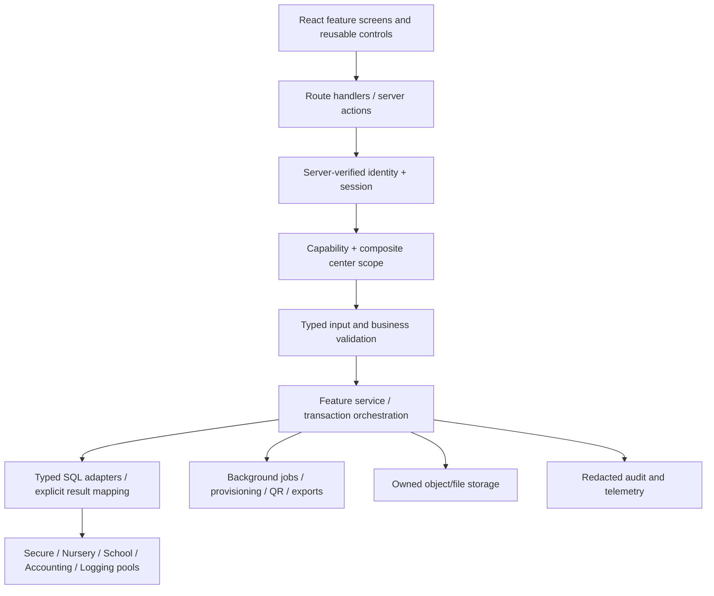

# Rebuild architecture and interface specification

## Decision: Next.js, React, TypeScript, and existing SQL Server

Use the **Next.js App Router on a Node.js server**, React, strict TypeScript, Zod boundary validation, and `mssql` for controlled SQL Server adapters. Dependencies are pinned in package-lock.json; the prepared foundation uses Next.js 16.4.2 and React 19.3.1, verified from npm on 21 October 2026. The local runtime is Node 22.17.0. There is no reason to migrate the production databases just to modernize the portal.

Angular is also viable, particularly for a team already maintaining Angular applications. The audit shows many stateful CRUD screens and reports but no requirement for Angular-specific infrastructure, an existing Angular codebase, or an independently consumed API. Next.js allows a single TypeScript app with a same-origin server boundary and a gradual feature rollout. That is the deciding factor here, rather than a claim that React is universally better. If team standards later require Angular, retain the documented domain contracts and move the same service boundaries behind a dedicated API.

Use a maintained component system when expanding forms/tables (evaluate Radix/shadcn components or the organization's existing library) rather than hand-building every complex interaction. The present foundation uses semantic HTML controls, a native modal dialog, Lucide icons, and a small token-based CSS system to remain easy to inspect. Large datasets should use server pagination and a table/query layer; the sample's in-memory table is not the production data strategy.

Retain a **modular monolith** initially: one deployment, explicit feature/service/repository boundaries, independent SQL pools, and background jobs for heavy operations. Microservices would add operations without solving the observed permission and contract issues.

The [available-database review](07-database-inspection.md) supports this decision. It verified distinct Nursery/School signatures, cross-database provisioning transactions, ownership/page grants, local/secure credential synchronization and trigger side effects. The subsequent [phase-one implementation](08-authentication-and-centers.md) adds explicit adapters and permission checks. Restricted TLS/account acceptance remains necessary for live access; reference/account/filesystem issues gate live provisioning. Accounting/Logging remain pending.

References consulted: [Next.js App Router](https://nextjs.org/docs/app/getting-started), [installation requirements](https://nextjs.org/docs/app/getting-started/installation), [React version documentation](https://react.dev/versions), and [node-mssql primary documentation](https://github.com/tediousjs/node-mssql). npm registry results were used to pin actual dependency versions rather than infer them from documentation crawl dates.

## Layer boundaries



Browser code never imports SQL, a connection configuration, provider secret, trusted principal, or legacy credential verifier. `server-only` marks relevant modules. Services receive a server-verified actor; permission checks happen inside the request/service boundary before a target is fetched or changed. Menus are a convenience, not enforcement. Jobs and downloads repeat authorization using actor and target identity.

## Prepared project layout

```text
src/app/                       App Router screens and HTTP boundaries
  login/                       Existing dealer sign-in and explicit isolated demo entry
  (workspace)/                 Protected overview, directory, profile and access pages
  (workspace)/[module]/        Honest pending destinations for later modules
  api/health/                  Process health, no secrets or connection attempt
  api/auth/, api/centers/       Session lifecycle and scoped center operations
  api/center-drafts/            Owned drafts; demo-only publication
  api/live/centers/             Real-account-only scoped directory
src/components/                Shell, native dialog, shared icons
src/domain/                    Center identity/coordinates/drafts, access policy
src/features/registry.ts       Every module and legacy-page migration owner
src/features/centers/          Directory, profile editor, draft wizard and fictional fixtures
src/server/auth/               Audited dealer verifier and opaque server sessions
src/server/db/                 Five-role pooled SQL infrastructure, gated and TLS required
src/server/centers/            Explicit scoped SQL and isolated demo adapters
src/server/store.ts            Durable private sessions, limits, drafts and demo data
tests/                         Permission, domain, inventory, browser checks
scripts/audit-legacy.mjs       Redacted reproducible static source inventory
scripts/sql/                  Metadata discovery for staging
docs/                          Evidence, design, decisions, rollout
```

No ORM schema has been invented from page fields. The SQL adapter is intentionally not a generic arbitrary-procedure endpoint. When implementing each feature, allowlist the exact procedure and SQL types, pass values as parameters, map outputs explicitly, and reject unexpected shapes. A caller must not choose a database role, procedure, or SQL identifier through a request body.

## Proposed API contracts

These are **implementation specifications**, not working endpoints unless stated. Use same-origin route handlers initially; choose a versioned prefix before exposing APIs to other clients.

| Resource / method                                       | Purpose                                       | Permission and special constraints                                                     |
| ------------------------------------------------------- | --------------------------------------------- | -------------------------------------------------------------------------------------- |
| GET /api/health                                         | Liveness                                      | Implemented; reveals no config/credentials                                             |
| GET /api/live/centers                                   | Real-account-only scoped directory            | Anonymous 401; demo 403; real account requires restricted TLS configuration            |
| GET /api/centers                                        | Cursor list with search/type/status/dealer    | centers.read; scope rows before paging; bounded limit                                  |
| GET/PATCH /api/centers/{type}/{id}                      | Profile read/update                           | centers.read/write; allowlisted fields; revision/ETag                                  |
| POST /api/center-drafts                                 | Create owned provisioning draft               | centers.create; independent draft per workflow                                         |
| PATCH /api/center-drafts/{id}                           | Profile/branding/location/admin steps         | Draft owner plus permission; server validation                                         |
| POST /api/center-drafts/{id}/provision                  | Commit and enqueue durable setup              | Idempotency key; provisioning state and partial-failure results                        |
| GET/PATCH /api/centers/{type}/{id}/administrator        | Admin identity/contact                        | users.manage; no password property in read DTO                                         |
| POST /api/centers/{type}/{id}/administrator/invitations | Invite/reset                                  | users.manage; short-lived single-use token, audit                                      |
| GET/POST/PATCH /api/dealers                             | Dealer account lifecycle                      | dealers.manage; separate actor and target; prevent accidental privilege escalation     |
| PUT /api/dealers/{id}/grants                            | Approved capability/scope assignment          | Explicit policy; no numeric-ID exemptions                                              |
| POST /api/centers/{type}/{id}/activation                | Change availability                           | status.manage; confirmation/reason, current revision                                   |
| GET/POST/PATCH/DELETE /api/payments                     | Ledger operations                             | payments.read/write; derive center ownership from stored record for edits/deletes      |
| GET /api/reference/{kind}                               | Currency/status/input type/year/bus reference | Explicit allowlist; correct DB and bounded cache                                       |
| GET/PUT /api/centers/{type}/{id}/gateway                | Metadata / replace configuration              | integrations.manage; write-only secrets; callback URL not caller-controlled by default |
| POST /api/alerts/publish and /reset                     | Multi-center message action                   | alerts.write/reset separately; nonempty typed recipients; per-target results           |
| GET/PUT /api/centers/{type}/{id}/buses/{busId}/settings | Effective/default bus settings                | transport.manage; validate bus-to-center ownership and lookup IDs                      |
| GET /api/activity                                       | Month or school-year report                   | reports.read; agreed billing calculation; no side effects                              |
| POST /api/exports                                       | Create report job                             | reports.export; scope selected centers, capture calculation version                    |
| GET /api/exports/{id} and /download                     | Job status and short-lived file               | Job owner or explicit scoped permission; current authorization                         |
| Export delivery audit within job service                | Preserve Center_Invoicing download history    | Actor/center scope and idempotency; no invented invoice-posting or charge command      |
| GET /api/audit                                          | Business audit search                         | audit.read; retention/privacy controls                                                 |

Use error envelopes `{error:{code,message,requestId,fields?}}`; never return stack traces, SQL text, secret values, or raw provider errors. Use 401 unauthenticated, 403 unauthorized, 404 unavailable/hidden target as policy requires, 409 conflict, 422 validation, 429 throttling, 503 dependency unavailable. Successful write DTOs include the committed revision and confirmed status. No success toast before persistence.

## User interface system

The current interface uses the owner's requested **light-blue/white palette**, navy text, restrained blue accents and an independent visual system. It includes responsive navigation, a dedicated sign-in page, clear data tables, center details, a draft stepper and access/session controls. No imagery or styling was imported from another project. [Chapter 08](08-authentication-and-centers.md) supersedes the original sample-only layout and identity boundary described earlier in this architecture record.

Production conventions:

- A persistent center context shows name **and type**. Tabs: profile, branding, location, administrator, activity, payments, transport, integration, audit. Context never relies on one shared session variable.
- Search/dealer/type/status/date filters use URL state and server pagination. Keep sorting stable, display result totals and clear filters, and define whether bulk selection means current page or all filtered rows.
- Creation is an owned multi-step draft with save/resume, inline errors, file previews, a review step without passwords, and visible provisioning progress. School-specific fields are conditional. Existing drafts in another tab remain independent.
- Mutation dialogs show target and consequences. High-impact actions (deactivation, payment deletion, credential replacement, bulk reset) require a deliberate confirmation with clear pending/error/success states. Use optimistic updates only where safely reversible and reconciled.
- Label statuses explicitly; color supplements text. Keyboard access, visible focus, Escape/return focus for dialogs, label associations, error summary/live regions, touch sizes, zoom, reduced motion, contrast, and mobile overflow are acceptance criteria.
- Date-only fields and money display use defined locale/currency rules. RTL/Arabic support is a product decision; prepare logical CSS properties and localized strings before adding it, without assuming existing unused language models mean translated workflows exist.
- Export progress uses server job state and a visible download/history record, replacing polling a cookie that also signals failures. Partial alert/provisioning failures list affected centers and safe retry options.

## Identity and secret choices

The owner selected existing iCare dealer accounts for phase one. The audited SQL verifier now feeds opaque server sessions with idle/absolute expiry and revocation. OIDC/MFA remain a future coordinated migration, particularly because shared center-user credentials have additional consumers. Current implementation and deployment limits are in chapter 08.

Map existing ownership and page 7/8/9 grants into an approved capability matrix. List access and mutation access differ in the legacy SQL. Dealer login hashing is now known, but local center-user plaintext compatibility, the password-bearing log call and other app consumers prevent an isolated password-store replacement. Restrict list DTOs to non-secret fields even when legacy SELECT * returns more.

Credential storage belongs to the provider or a reviewed migration verifier, never to UI draft objects. Gateway/SQL secrets live in a managed secret store or private environment variables; API responses expose configured/rotated metadata only. Database TLS and least privilege are mandatory in new adapters. Pool errors log a role label, not the raw connection/error payload.

## Deployment and extension strategy

Deploy the Node server near SQL Server with network access to all five roles (a Windows/Linux VM/container, existing internal reverse proxy, or an approved app hosting service). SQL TCP support is required. Do not assume a browser-only static host or a restricted edge worker can reach existing databases. Preserve the old IIS site during staged rollout. No hosting registration or deployment is part of this local preparation.

Ship CI with pinned npm install, type checking, meaningful domain/security tests, app build, integration tests against staging, and browser/accessibility checks. Add redacted request IDs, connection pool health, slow query/export metrics, and business audit before live writes. Define backup/restore and file retention/recovery procedures before cutover.

To add a feature: define its business contract and permission; add its module and route; implement typed validation/service/repository mapping; add audit behavior; test cross-center denial, business invariants and failure paths; then enable behind a feature flag after staging acceptance. Do not grow another global DML module or use a generic unchecked CRUD endpoint.
